# **Práctica 2.3 - Instalar clientes para tres SGBD**
##### _Amparo Sánchez Ledo - ASIR 2 - 14/10/2026_

> Antes de comenzar, debemos tener en cuenta que en esta práctica vamos a instalar y probar clientes de consola, gráficos y web para poder conectarnos a los tres SGBD que instalamos en la tarea anterior (Oracle Database 23ai Free, PostgreSQL y MariaDB).


> Nota: Deben estar funcionando los tres servidores y conocer la IP, puerto, base o servicio y el usuario de trabajo. Comprobaremos antes de comenzar, que la conexión de los tres SGBD que instalamos anteriormente es correcta con _nc -zv IP PUERTO_:


---

### **_Datos generales para las conexiones_**

| SGBD | Servidor | Base/servicio | Puerto | Usuario |
| :--- | :--- | :--- | :--- | :--- |
| **Oracle 23ai Free** | localhost o IP de VM | FREEPDB1 | 1521 | orauser |
| **PostgreSQL** | localhost o IP de VM | dbpg | 5432 | pguser |
| **MariaDB** | localhost o IP de VM | dbm | 3306 | muser |

> Nota sobre conexiones externas: Si te conectas desde otro equipo, verifica que la red lo permita. El comando nc -zv IP PUERTO confirma si el puerto está abierto y accesible, aunque no garantiza que las credenciales de inicio de sesión funcionen.

---

## **_1. Clientes para Oracle Database (en Mint/Debian)_**

### **_1.1 Cliente gráfico: SQL Developer_**

Comenzamos con los clientes para Oracle, donde el primero será el cliente gráfico SQL Developer. Lo primero es instalar un JDK compatible con la versión de SQL Developer que vayamos a descargar, así que debemos comprobarla primero. Primero actualizaremos la lista de paquetes, seguidamente instalaremos Java y mostraremos la versión de este:

```
sudo apt update

sudo apt install default-jdk unzip

java --version
```

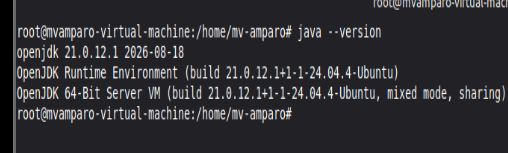

Descargamos el ZIP de SQL Developer (enlace [aquí](https://www.oracle.com/database/sqldeveloper/technologies/download)) en nuestra máquina virtual:

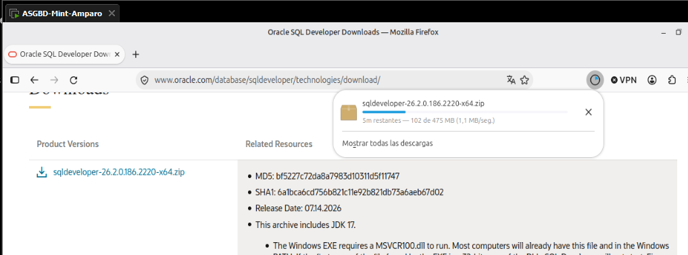

Accedemos a la carpeta de descargas con `cd Descargas` y vamos a descomprimir en /opt usando el nombre real del archivo con `sudo unzip NOMBRE_ARCHIVO_SQLDEVELOPER.zip -d /opt/`

E iniciamos SQL Developer con `/opt/sqldeveloper/sqldeveloper.sh`.

<!--(En este punto, ha saltado la incidencia 1)-->


---

> Opcional: Creamos un lanzador de menú. Para ello comprobaremos primero que las rutas de Exec e Icon coinciden con lo descomprimido. Ejecutaremos el comando `sudo tee /usr/share/applications/sqldeveloper.desktop > /dev/null <<'EOT'` y escribiremos lo siguiente:
```
[Desktop Entry]
Version=1.0
Name=SQL Developer
Comment=Entorno de desarrollo SQL
Exec=/opt/sqldeveloper/sqldeveloper.sh
Icon=/opt/sqldeveloper/icon.png
Terminal=false
Type=Application
Categories=Development;Database;
Keywords=database;db;sql;query;administration;
EOT
```

---

Y dentro de Oracle SQL Developer crearemos una conexión donde:

- Usuario: orauser
- Puerto: 1521
- Nombre de servicio: FREEPDB1

En caso de que el cliente esté en la misma VM (que es este caso) usaremos **localhost**; si está en otro equipo, usaremos la **IP del servidor** y comprobaremos que la red permita el acceso.

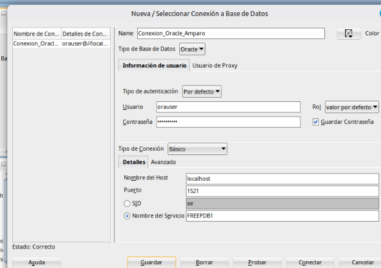

> Nota: Para comprobar que está bien, abajo a la izquierda debe salir **Estado: Correcto**.

---

### **_1.2 Cliente gráfico: VS Code y extensión SQL Developer_**

Pasamos a otro cliente gráfico. En este caso será el **VSCode y la extensión SQL Developer**. Lo primero será descargar el paquete .deb actual de VSCode (enlace [aquí](https://code.visualstudio.com/)) y una vez que lo tengamos descargado accedemos a la carpeta de **Descargas** (en caso de que no estemos en ella) e instalamos el paquete con los siguientes comandos:


```
cd ~/Descargas

sudo apt install ./NOMBRE_DEL_ARCHIVO_CODE.deb
```

Seguidamente, abriremos VS Code (desde la terminal es poniendo `code` y se abre) y en las extensiones buscamos e instalamos la de **Oracle SQL Developer for VS Code**, configurando una conexión a **FREEPDB1** como **orauser**.

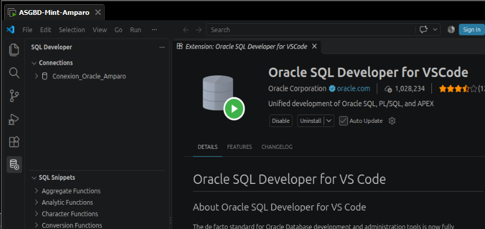

---

### **_1.3 Cliente de terminal: SQL*Plus_**

Para Mint (como es este caso) usaremos los ZIP oficiales de Oracle Instant Client para Linux x86-64 Basic y SQL*Plus de la misma versión (enlace [aquí](https://www.oracle.com/database/technologies/instant-client/downloads.html)) y la vamos a descomprimir ambas en un mismo directorio. La ruta será ~/oracle_amparo

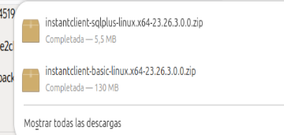

```
mkdir -p ~/oracle_amparo

unzip ~/Descargas/NOMBRE_BASIC.zip -d ~/oracle_amparo

unzip ~/Descargas/NOMBRE_SQL_PLUS.zip -d ~/oracle_amparo

ls ~/oracle_amparo
```

> Nota: Es posible que al descomprimir el segundo en la carpeta (ya sea el basic o el SQL) nos preguntará si queremos reemplazar algunos archivos (ya que ambos ZIP contienen archivos iguales), por lo que debemos escribir **A** (de All) para unificar todos los archivos sin repetirse.

Quedando el contenido de la carpeta que creamos de la siguiente manera:

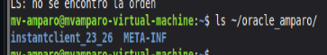

Entraremos al directorio **instaclient_...** creado por los ZIP y comprobaremos los ejecutables. En caso de que sea necesario, configuraremos las rutas de bibliotecas dependiendo de las instrucciones oficiales de la versión. Configuramos las variables de entorno y seguidamente probamos la conexión:

> Nota: sustituye instaclient_XX_X por el directorio real

```
export LD_LIBRARY_PATH="$HOME/oracle-client/instantclient_XX_X:$LD_LIBRARY_PATH"

export PATH="$HOME/oracle-client/instantclient_XX_X:$PATH"

sqlplus -v

sqlplus orauser@//localhost:1521/FREEPDB1
```

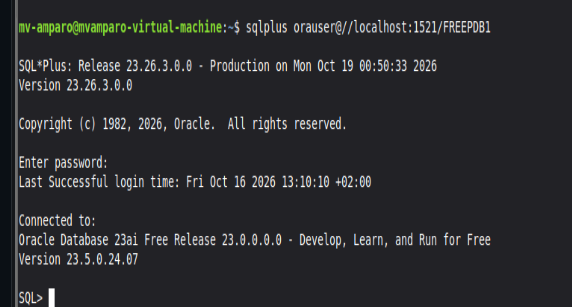

> Error documentado: En caso de que la biblioteca **libaio** falta, instalaremos el paquete corresponiente a la distribución. Pedirá la contraseña en la terminal.

---

### **_1.4 Cliente de terminal: SQLcl_**

Empezaremos instalando Java y comprobando la versión:

```
sudo apt install default-jdk unzip

java --version
```


Descargamos SQLcl (enlace [aquí](https://www.oracle.com/database/sqldeveloper/technologies/sqlcl/download/)) y se descomprime el zip:

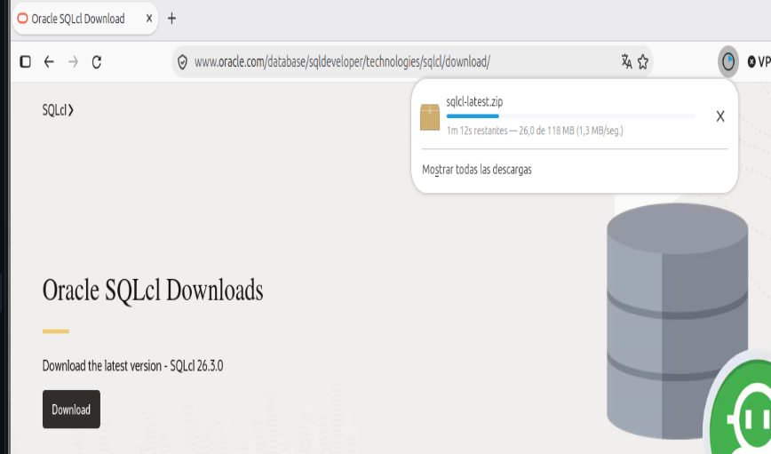

```
cd ~/Descargas

unzip NOMBRE_DEL_ARCHIVO_SQLCL.zip -d ~/sqlcl

~/sqlcl/sqlcl/bin/sql -version
```

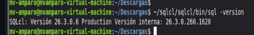

> En caso de que se quiera poder ejecutar sql desde cualquier terminal, añade `export PATH="$HOME/sqlcl/sqlcl/bin:$PATH"` a ~/.bashrc y abre una terminal nueva 

Ahora, probaremos la conexión con orauser y FREEPDB1 (sin contraseña)

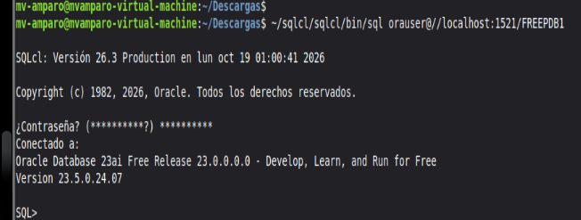

---

## **_2. Clientes para postgreSQL_**

### **_2.1 Cliente de terminal: psql_**

Pasamos a PostgreSQL, al cliente de terminal psql: actualizaremos los repositorios, instalaremos el cliente, veremos la versión y nos conectaremos a la base de datos con **pguser** de manera segura:

```
sudo apt update

sudo apt install postgresql-client

psql --version

psql -U pguser -d dbpg -W
```

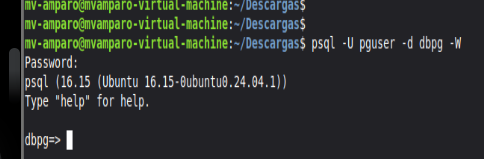

> Instala el paquete correspondiente si se necesita una versión en concreto del cliente (postgresql-client-14) y ésta existe. Hay que comprobar antes la disponibilidad con `apt search postgresql-client`

---

### **_2.2 Cliente gráfico: pgAdmin 4_**

Empezaremos comprobando si la versión de Debian o la base de Ubuntu está admitida (consultando este [enlace](https://www.pgadmin.org/download/pgadmin-4-apt/)):

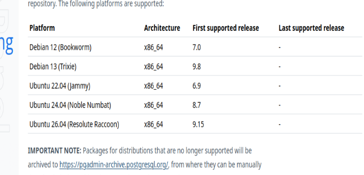

```
sudo apt install curl gnupg lsb-release

curl -fsS https://www.pgadmin.org/static/packages_pgadmin_org.pub | sudo gpg --dearmor -o /etc/apt/keyrings/packages-pgadmin-org.gpg

sudo sh -c 'echo "deb [signed-by=/etc/apt/keyrings/packages-pgadmin-org.gpg] https://ftp.postgresql.org/pub/pgadmin/pgadmin4/apt/noble pgadmin4 main" > /etc/apt/sources.list.d/pgadmin4.list'

sudo apt update

sudo apt install pgadmin4-desktop
```

> Nota sobre pgAdmin en Mint: El comando oficial falla porque lsb_release -cs devuelve el nombre de Mint, el cual no es admitido por el repositorio. Para solucionarlo, hay que seguir el apartado específico de Mint en su web oficial (cambiando ese valor por el de su base Ubuntu, como jammy o noble). 

Tras instalarlo, se abre pgAdmin desde el menú y se conecta a la base dbpg como pguser.

> Para conectarnos, hacemos clic derecho en Servers > Register > Server. En General, escribimos el nombre que queramos (y si se quiere comentario, también) y en Connection escribimos:
> - Host name/address: 192.168.248.128 (la ip real que tiene la máquina)
> - Port: 5432
> - Maintenance database: dbpg
> - Username: pguser
> - Password: la contraseña que usamos en el usuario.
>
> (Marcamos la casilla Save password para que no la vuelva a pedir)

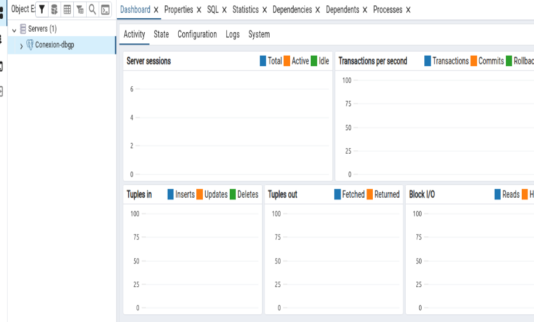

---

## **_3. Clientes para MariaDB_**

### **_3.1 Cliente de terminal: mariadb (o mysql)_**

Comenzaremos actualizando repositorios, instalando el cliente, viendo la versión de mariadb y probando la conexión a la base de datos con **muser**:

```
sudo apt update

sudo apt install mariadb-client

mariadb --version

mariadb -h localhost -u muser -p dbm
```

> Nota: El parámetro -p hará que el programa solicite la contraseña en la terminal.

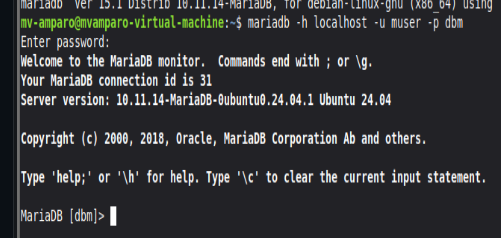

---

### **_3.2 Cliente web: phpMyAdmin_**

Al igual que antes con mariadb, actualizamos repositorios e instalamos el cliente:

```
sudo apt update

sudo apt install apache2 php php-mysql php-mbstring php-zip php-gd php-curl phpmyadmin
```

> Nota durante la instalación: Selecciona apache2 si el asistente lo pregunta y configura phpMyAdmin. La contraseña solicitada aquí es de almacenamiento interno; para conectarnos usamos el usuario **muser**.

Seguidamente habilitamos la extensión necesaria de PHP y reiniciamos el servidor Apache:

```
sudo phpenmod mbstring

sudo systemctl restart apache2
```

> Ruta alternativa: Si la ruta web no se habilita automáticamente, ejecuta:
> ```
>sudo a2enconf phpmyadmin
>
>sudo systemctl reload apache2.
>```

Finalmente, abrimos el navegador en [http://localhost/phpmyadmin/](http://localhost/phpmyadmin/) e iniciamos sesión con muser para comprobar la base de datos.

Pantalla inicial:

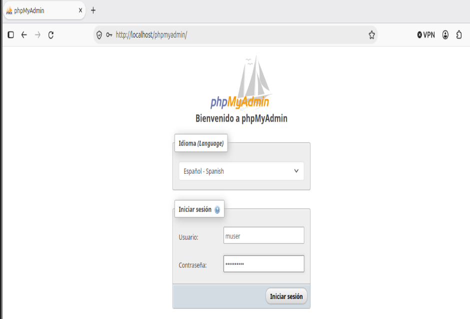

Conexión establecida:

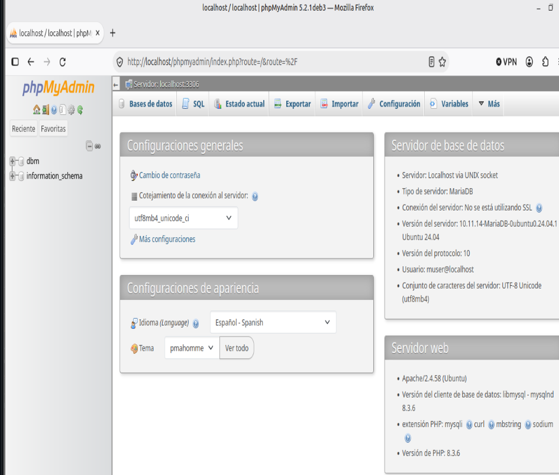

---

## **_4. Clientes para varios SGBD_**

### **_4.1 DBeaver Community_**

Descargamos el paquete .deb actual desde su [web oficial](https://dbeaver.io/download/) y lo instalamos mediante la terminal:

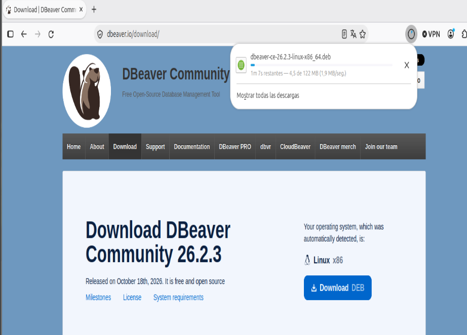

```
cd ~/Descargas

sudo apt install ./NOMBRE_DEL_ARCHIVO_DBEAVER.deb
```

Una vez abierto DBeaver, configuramos las tres conexiones apuntando a localhost (Oracle FREEPDB1 con orauser, PostgreSQL dbpg con pguser y MariaDB dbm con muser). Es normal que el programa solicite la descarga automática de los controladores JDBC al intentar conectar.

> Para crear las conexiones le damos clic derecho a **DBeaver Sample Database (SQLite) > Create New Connection** y seleccionamos el icono dependiendo de la conexión que queramos crear.

> Recordatorio para la creación de las conexiones:
>
> | Tipo de conexión | Oracle | PostgreSQL | Mariadb |
> | --- | --- | --- | --- |
> | Host | localhost | 192.168.248.128 | 192.168.248.128 |
> | --- | --- | --- | --- |
> | Puerto | 1521 | 5432 | 3306 |
> | --- | --- | --- | --- |
> | Base de datos | FREEPDB1 | dbpg | dbm |
> | --- | --- | --- | --- |
> | Usuario | orauser | pguser | muser |
>
> En todos debemos hacer un **Test Connection** antes de finalizar, y nos pedirá que nos descarguemos los drivers. Los descargamos y una vez que nos acepte la conexión, finalizamos.

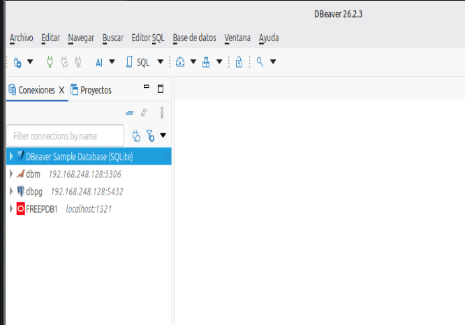

---

### **_4.2 Adminer_**

Adminer es un cliente web muy ligero compuesto por un único archivo PHP. Instalamos el paquete PHP CLI para la terminal, descargamos el archivo y levantamos un servidor local de prueba:

```
sudo apt install php-cli

wget https://www.adminer.org/latest.php -O adminer.php

php -S 127.0.0.1:8080 adminer.php
```

Para probarlo, abrimos el navegador en la misma máquina virtual entrando a [http://localhost:8080/](http://localhost:8080/). Seleccionamos el motor (PostgreSQL o MySQL/MariaDB) y probamos la conexión con los usuarios de trabajo correspondientes. Para apagar el servidor web desde la terminal, pulsamos Ctrl+C.

Conexión con PostgreSQL:

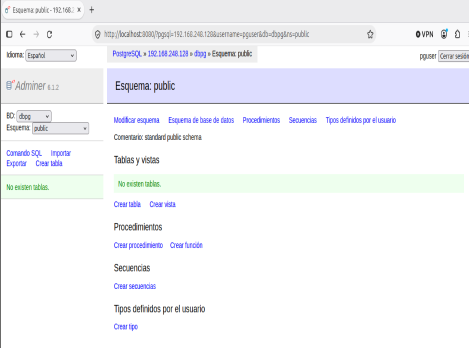

Conexión con MariaDB:

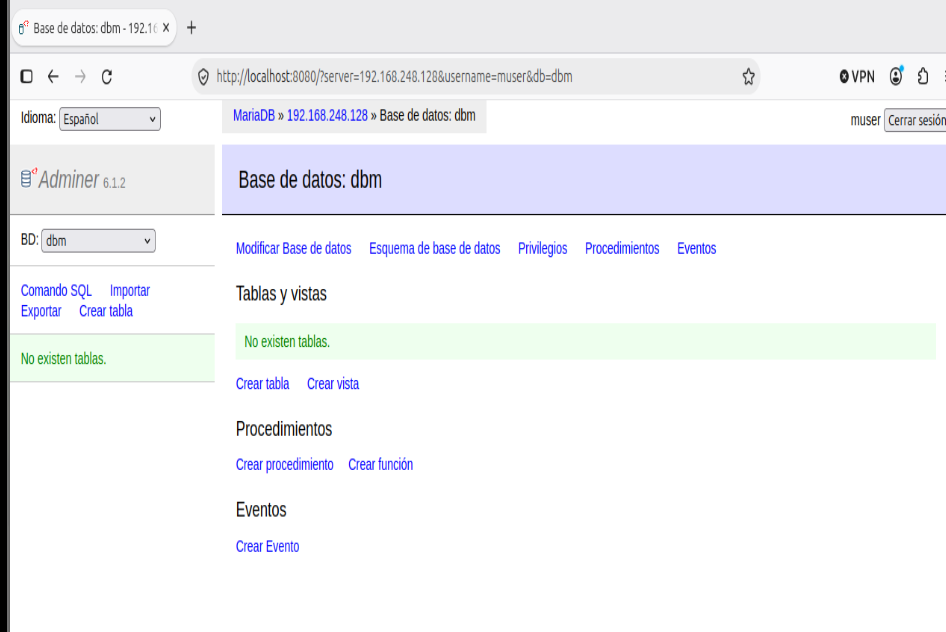

---

## **_Incidencias_**

#### **_Incidencia 1_**

Durante el inicio de SQL Developer (usando el comando `/opt/sqldeveloper/sqldeveloper.sh`) me ha saltado el error **Module javafx.base not found**: lo que ocurre es que Oracle ha dejado **AddLinuxVMOption --module-path=../../modules/javafx/linux-x64/lib**, pero la carpeta linux-64 no existe en el ZIP. Java intenta arrancar con --add-modules=javafx.base,... pero apuntando a un directorio vacío.

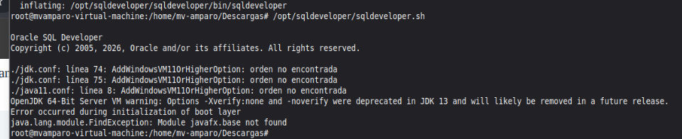

> El error se ha solucionado ejecutando ciertos comandos, cuyas finalidades son:

> 1. sed -i 's|...|...|' (Reparación): Sustituye la ruta errónea que venía de fábrica en el archivo de configuración de Oracle por la ruta correcta donde tu sistema Linux Mint almacena realmente las librerías gráficas de JavaFX.
> 2. grep -n module-path (Comprobación): Busca y muestra en pantalla la línea recién modificada para que puedas verificar visualmente que el cambio del paso anterior se ha guardado con éxito.
> 3. sed -i '/module-path/d' (Limpieza): Elimina cualquier rastro de configuración gráfica errónea en los archivos temporales de tu usuario, limpiando los intentos fallidos anteriores para evitar que interfieran en el arranque limpio.

> Los comandos completos son los siguientes:

```
sudo sed -i 's|--module-path=../../modules/javafx/linux-x64/lib|--module-path=/usr/share/openjfx/lib|' /opt/sqldeveloper/sqldeveloper/bin/java11.conf

grep -n module-path /opt/sqldeveloper/sqldeveloper/bin/java11.conf

# La línea 9 debe decir ahora AddLinuxVMOption --module-path=/usr/share/openjfx/lib

sed -i '/module-path/d' ~/.sqldeveloper/26.2.0/product.conf
```

---

#### **_Incidencia 2_**

Tras configurar las variables del entorno e intentar conectarnos, nos saltó un error de que faltaba la librería libaio y no se podía conectar:

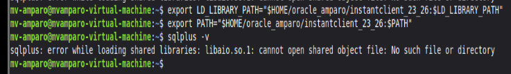

> El error se ha solucionado simplemente instalando la librería faltante con el comando `sudo apt install libaio1`

En caso de que la instalación devuelva el siguiente error:

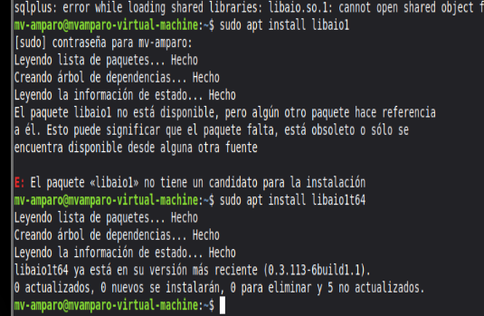

> Ejecutaremos el comando `sudo ln -s /usr/lib/x86_64-linux-gnu/libaio.so.1t64 /usr/lib/x86_64-linux-gnu/libaio.so.1` y ya podremos hacer la conexión.

---

#### **_Incidencia 3_**

Durante la conexión con el usuario pguser y usando el comando `psql -h localhost -U pguser -d dbpg -W`, saltó un error de fallo de conexión:

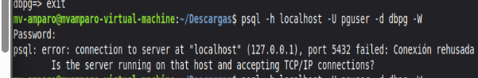

> El error se ha solucionado usando el comando `sudo nano /etc/postgresql/16/main/pg_hba.conf`, buscando la línea **local all all peer** abajo del todo del fichero y reemplazando **peer** por **scram-sha-256**.

> Además, en vez de ejecutar el comando `psql -h localhost -U pguser -d dbpg -W`, omitiremos la parte de **-h localhost** para poder conectarnos.

---

### **_Incidencia 4_**

Al intentar registrar el servidor local en pgAdmin 4 usando localhost (127.0.0.1), el sistema devolvía el error "Connection refused".

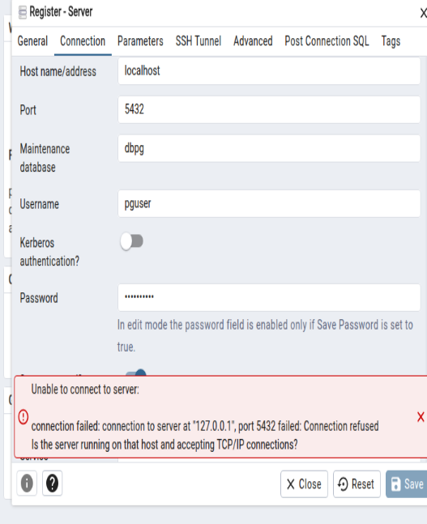

Todo esto se debe a que el archivo de configuración principal (postgresql.conf) estaba anclado estrictamente a la IP de la tarjeta (`listen_addresses = '192.168.248.128'`).

> El error se ha solucionado ajustando los datos de conexión en el cliente gráfico, de manera que en vez de apuntar a localhost, se ha utilizado directamente la IP real (192.168.248.128).

---

### **_Incidencia 5_**

Al crear la conexión en DBeaver con MariaDB, me saltó un error durante el Test de Conexión, y es que no reconocía la conexión.

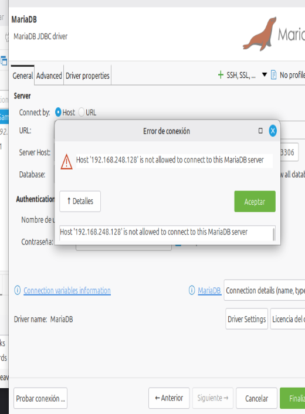

Esto se debe a una falta de permisos al crear el usuario **muser**, y es que no se le aplicaron correctamente.

> El error se ha solucionado entrando a MariaDB como administrador usando `sudo mariadb` y escribiendo lo siguiente:
>
> ```
> GRANT ALL PRIVILEGES ON dbm.* TO 'muser'@'%' IDENTIFIED BY 'CONTRASEÑA';
> 
> FLUSH PRIVILEGES;
> ```

---

## **_Fuentes consultadas_**
- Guión de la práctica: "Instalar clientes para tres SGBD".

- [Oracle (SQL Developer y SQLcl)](https://www.oracle.com/database/sqldeveloper/)

- [Oracle (Instant Client)](https://www.oracle.com/database/technologies/instant-client/downloads.html)

- [Visual Studio Code](https://code.visualstudio.com/)

- [pgAdmin 4](https://www.pgadmin.org/download/pgadmin-4-apt/)

- [DBeaver Community](https://dbeaver.io/download/)

- [Adminer](https://www.adminer.org/)

- Resolución de incidencias: Documentación de OpenJFX para el error de java11.conf.